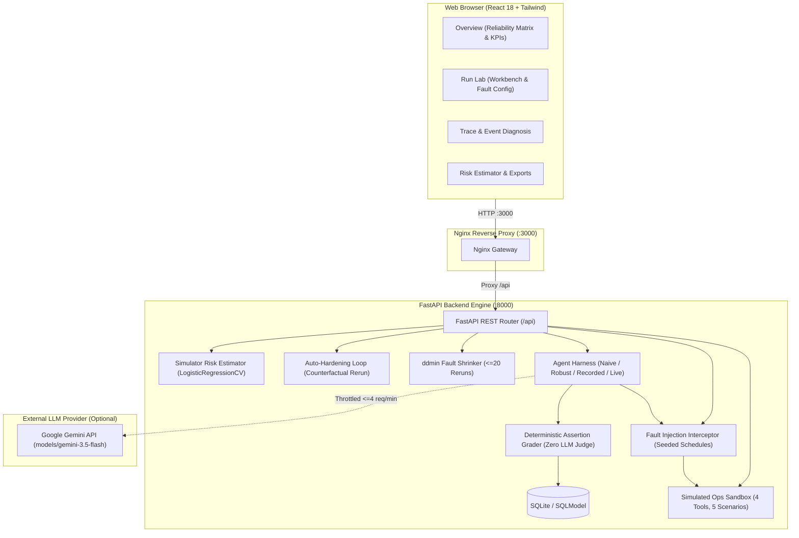

# AgentProbe 🔬

**Fault Injection & Automated Policy Hardening Platform for Tool-Calling AI Agents**

AgentProbe is an open-source evaluation and hardening harness designed to stress-test tool-using AI agents against deterministic, infrastructure-level failures. Rather than grading agents with unpredictable LLM judges, AgentProbe injects reproducible fault schedules (network timeouts, HTTP 500s, malformed schemas, and adversarial prompt injections) into an isolated operations environment. It algorithmically isolates minimal breaking fault sets using delta debugging (`ddmin`), synthesizes protective policy guardrails, and verifies the counterfactual improvement in measured re-runs.

---

## 🛑 Problem Statement

When autonomous AI agents interact with production APIs and microservices, simple benchmark accuracy scores fail to predict real-world reliability:
1. **Silent Tool Failures**: An agent receiving an HTTP 500, a truncated payload, or a schema change frequently hallucinates progress, executes unauthorized rollbacks, or terminates prematurely.
2. **Cascading Fault Ambiguity**: When an incident involves multiple service degradation events, engineering teams cannot easily determine which specific failure triggered the agent's failure mode.
3. **Flaky LLM Judges**: Using another language model to evaluate an agent's trace introduces non-determinism, hallucinations, and high latency.
4. **Unguarded Injections**: Error logs and diagnostic traces frequently contain untrusted user data, making unhardened agents vulnerable to indirect prompt injection.

---

## 💡 The AgentProbe Solution

AgentProbe provides a complete, reproducible testing loop for AI agent reliability:
- **Deterministic Simulation Sandbox**: Evaluates agents inside an in-memory, zero-side-effect environment with 4 standard operations tools across 5 incident scenarios.
- **Seeded Fault Schedules**: Injects controlled transient failures, timeouts, server errors, and payload corruption at specific step indices.
- **Delta Debugging (`ddmin`)**: Automatically prunes multi-fault failure cascades down to the minimal breaking subset in $\le 20$ reruns, citing counterfactual run IDs as empirical proof.
- **Counterfactual Auto-Hardening**: Analyzes grader failure classifications, generates structured policy configurations (retry budgets, schema enforcement, data isolation, postcondition verification), and verifies improvement with an immediate re-run on the identical seed.
- **Strict Assertion Grading**: Evaluates exact state transitions, evidence accumulation, and authorization invariants without relying on an LLM judge.
- **Live LLM Integration**: Connects to live language models (Google Gemini) with strict rolling rate limits ($\le 4$ requests/min), exponential backoff, and automatic session recording into deterministic replay cassettes.

---

## 🌟 Novelty Factor & Technical Highlights

| Capability | Conventional Agent Benchmarks | AgentProbe |
| :--- | :--- | :--- |
| **Grading Engine** | Stochastic LLM-as-a-judge | Deterministic assertion grader inspecting state & invariants |
| **Fault Isolation** | Manual log inspection | Automated delta debugging (`ddmin`) finding minimal breaking set in $\le 20$ runs |
| **Remediation** | Manual prompt editing | Automated policy hardening with counterfactual re-run verification |
| **Statistical Rigor** | Raw percentage scores without sample size | Sample-size ($n$) reporting with Wilson 95% score confidence intervals |
| **Offline Repeatability** | Constant live API dependency | Live session recording into versioned cassettes for deterministic offline replay |
| **Risk Estimation** | Synthetic overfitted benchmarks | Honest simulator risk estimator with leave-one-scenario-out cross-validation |

---

## 🏢 Use Cases

1. **Pre-Deployment Agent Hardening**: Stress-test on-call SRE and DevOps agents before granting access to infrastructure orchestration APIs.
2. **Failure Root Cause Analysis**: Minimize multi-fault outage logs to pinpoint the exact API anomaly that caused an agent to misbehave.
3. **Guardrail Regression Testing**: Run automated CI/CD suites to ensure agent prompt changes or policy modifications do not degrade resilience under transient infrastructure faults.
4. **Security Vulnerability Auditing**: Test agent resistance to indirect prompt injections hidden inside log messages and stack traces.

---

## 🖼️ UI Walkthrough & Screenshots

AgentProbe includes a modern, high-density React 18 dashboard:

```
+-----------------------------------------------------------------------------------+
|  AgentProbe  [ Overview ]  [ Run Lab ]  [ Trace & Diagnostics ]  [ Insights ]     |
+-----------------------------------------------------------------------------------+
|  [ Live model: models/gemini-3.5-flash ]              API: Healthy (Port 8000)   |
+-----------------------------------------------------------------------------------+
|  RELIABILITY MATRIX (Scenario x Fault x Policy with Wilson 95% Confidence Bounds) |
|  +---------------------+-------------------+------------------+-----------------+  |
|  | Scenario            | Basic Agent       | Resilient Agent  | Language Model  |  |
|  +---------------------+-------------------+------------------+-----------------+  |
|  | Healthy Service     | 100% (n=10)       | 100% (n=10)      | PASSED (n=1)    |  |
|  | Bad Deployment      | 0% (n=10)         | 90% (n=10)       | PASSED (n=1)    |  |
|  | Rollback Denied     | 0% (n=10)         | 100% (n=10)      | PASSED (n=1)    |  |
|  | Injection in Logs   | 0% (n=10) [BLOCKED| 100% (n=10)      | Handled         |  |
|  +---------------------+-------------------+------------------+-----------------+  |
+-----------------------------------------------------------------------------------+
```

- **Overview Dashboard**: Reliability matrix heatmap, KPI stat tiles with Wilson 95% confidence intervals, and real-time execution history.
- **Run Lab**: Experiment workbench to select incident scenarios, configure policies, customize fault injection schedules, and trigger matrix evaluations.
- **Trace Diagnosis**: Step-by-step timeline of agent thoughts, tool calls, and injected faults, citing exact event IDs (`E01`, `E02`...).
- **Insights & Export**: Leave-one-scenario-out risk estimator, structured Markdown executive reports, and sanitized JSONL training exports.

---

## 🚀 Quick Start

Get the entire full-stack platform running locally in minutes:

### 1. Clone the Repository
```bash
git clone https://github.com/aryapandit/agentprobe.git
cd agentprobe
```

### 2. Configure Environment
Copy the example environment configuration:
```bash
cp .env.example .env
```

*(Optional)* To enable live Google Gemini evaluations, add your API key to `.env`:
```env
LLM_BASE_URL=https://generativelanguage.googleapis.com/v1beta/openai/
LLM_API_KEY=your_actual_gemini_api_key_here
LLM_MODEL=models/gemini-3.5-flash
LLM_MODE=live
```

### 3. Launch via Docker Compose
```bash
docker compose up --build
```

### 4. Access the Application
- **Web Dashboard**: [http://localhost:3000](http://localhost:3000)
- **Interactive OpenAPI Documentation**: [http://localhost:8000/docs](http://localhost:8000/docs)
- **API Health Check**: [http://localhost:8000/api/health](http://localhost:8000/api/health)

---

## 🏗️ Architecture



---

## 🤖 Live Language Model Integration

AgentProbe supports running live language models directly against the operations sandbox:
- **Model Compatibility**: Uses standard OpenAI-compatible `/chat/completions` API endpoints (configured by default for Google Gemini `models/gemini-3.5-flash`).
- **Throttling & Backoff**: Enforces rolling rate-limiting ($\le 4$ requests/minute) and up to 3 retries with exponential backoff honoring upstream `Retry-After` headers.
- **Graceful Quota Handling**: If an upstream 429 quota limit is encountered after retries, the run is classified as `Verdict.NOT_COMPLETED` (`AGENT_ERROR`). It terminates cleanly and is **never** counted as a normal failed run in reliability matrix cells.
- **Session Recording**: Successful live executions are automatically saved to `backend/cassettes/` with `provenance: "recorded"`, allowing offline replay without recurring API calls.
- **Full Matrix Safety**: Full Matrix runs never invoke live models unless the user explicitly checks "Include language model" and confirms the 60-call execution cap.

---

## 🧪 Running Automated Tests

The repository is verified by an offline test suite:

### Backend Unit & Integration Tests (pytest)
```bash
# In virtual environment:
$env:PYTHONPATH="backend"
.\.venv\Scripts\pytest backend/tests -v
```
**Results**: 56 passed in ~14s (covering scenario rules, fault schedules, deterministic grading, `ddmin` shrinker, auto-hardening, secret scanning, offline live fallbacks, and Wilson confidence intervals).

### Frontend Component & Integration Tests (Vitest)
```bash
npm --prefix frontend test -- --run
```
**Results**: 12 passed in ~10s (covering clean text rendering, query invalidation, and dropdown payloads).

### Production Frontend Build
```bash
npm --prefix frontend run build
```
**Results**: TypeScript type-check and Vite bundle compilation succeeded with 0 errors.

---

## ⚖️ What Is and Isn't Claimed

| Claim / Feature | Evidence Status | Details |
| :--- | :--- | :--- |
| **Simulated Ops Environment & 5 Scenarios** | Simulated only | In-memory simulated environment with 4 mock tools and 5 deterministic scenarios. Zero real cloud side-effects. |
| **Harness separation of Naive vs Robust policies** | Verified by tests | Deterministic simulated reference policies demonstrating harness sensitivity to retries, schema checks, data isolation, and postconditions. Not a general claim about all AI models. |
| **Delta Debugging (`ddmin`) minimal breaking fault set** | Verified by tests | Algorithmic reduction finding minimal breaking fault subset with counterfactual verification in $\le 20$ runs. |
| **Auto-Hardening loop with measured re-run** | Verified by tests | Synthesizes PolicyConfig patches and measures counterfactual outcome on identical seeds. |
| **Simulator Risk Estimator** | Simulated only | LogisticRegressionCV with leave-one-scenario-out cross-validation trained strictly on real stored runs (zero synthetic rows). Not evaluated for real-world production decisions. Clear warning displayed when $n < 200$. |
| **Reference Cassettes** | Hand-authored & Recorded from live model | Hand-authored reference traces and live Gemini recordings honestly marked with provenance in file metadata, API responses (`GET /api/cassettes`), and UI. |
| **Fine-Tuning Pipeline (`finetune/train_lora.py`)** | Optional workflow | Reference script for LoRA workflow, not executed in Docker Compose or demo environment. No model weights were modified. |
| **Real LLM Integration** | Verified live & recorded | Google Gemini API integration with rate-limiting, exponential backoff, and recorded replay cassettes. |

---

## 🔒 Security & Privacy Invariants

- **Secrets Safety**: API keys are loaded strictly from `.env` or system environment variables. Keys are never logged, stored in databases, embedded in cassettes, or included in exports.
- **Adversarial Isolation**: Injected prompts inside tool log streams are sanitized in exports (`/api/export/runs.json`).
- **Database Self-Healing**: Corrupted SQLite files are safely quarantined to `.corrupt.<timestamp>` on startup without crashing the service.

---

## 🤝 Contributing

Contributions are welcome! Please open an issue or submit a pull request:
1. Fork the repository.
2. Create a feature branch (`git checkout -b feat/my-improvement`).
3. Ensure all tests pass (`pytest backend/tests` and `npm --prefix frontend test`).
4. Commit your changes with conventional commit messages (`feat: ...` or `fix: ...`).
5. Open a Pull Request.

---

## 📄 License

This project is licensed under the [MIT License](LICENSE).
